# CleanPlan architecture

A short tour of how the planner works and why it is built this way. Measured numbers are in
`backend/README.md`; the API contract is `CONTRACT.md`.

## Pipeline

```mermaid
flowchart LR
  subgraph offline["Offline data pipeline (scripts/)"]
    OSM[Overpass: addressed buildings + stations] --> DS[1,000 buildings + synthetic customer data]
    PBF[Geofabrik Greece PBF] --> CLIP[Athens clip] --> OSRM[OSRM foot graph]
    DS --> MAT[Walking matrix 1057² + leg geometries]
    OSRM --> MAT
  end
  subgraph solve["Optimiser (app/solver/)"]
    A[Areas: split where gaps > 6 min walk] --> K[Workforce K per area: from busiest-day bound up]
    K --> T[Territories: k-means seed + min-cost-flow balancing]
    T --> D[Day patterns per territory: CP-SAT]
    D --> R[Routes per cleaner and day: OR-Tools VRPTW, process pool]
    R --> X{Overflow?}
    X -- yes --> REP[Repair: re-pattern, move edge buildings, else K+1]
    REP --> R
    X -- no --> P[Plan + KPIs + hulls + street geometry]
  end
  MAT --> A
  P --> API[FastAPI: plan, what-ifs, route sheets, import]
  API --> UI[React + Leaflet UI]
```



1. **Areas.** Buildings more than 6 minutes' walk from every other building in a group form
   separate areas (e.g. Καλλιθέα vs Νέος Κόσμος). A territory never spans two areas, so nobody
   walks 20 minutes between neighbourhoods on a normal day. Tiny areas are merged into the nearest.
2. **Workforce.** Per area, K starts at the busiest-day lower bound (service plus the shortest
   possible walk into each visit, spread evenly over 10 days, at the target utilisation) and grows
   until every route fits. `num_cleaners` fixes K instead; the remainder is reported as `unassigned`.
3. **Territories.** Weighted k-means gives compact seeds (weight = 2-week service + estimated walk).
   A min-cost flow then assigns every building's workload to one of its nearest centres under equal
   capacities, which yields balanced, convex, non-interleaving regions (a power diagram). Capacity is
   reduced for territories far from a station, since their cleaners walk further to start.
4. **Days.** Per territory, CP-SAT picks one allowed pattern per building, so frequency rules and the
   2-day spacing hold by construction. Objective 1 minimises the busiest day. Objective 2 (with the
   busiest day held within 5 %) keeps each day geographically tight: the territory is pre-split into
   5 compact sub-areas, each preferring one weekday. Morning-only work per day is capped.
5. **Routes.** One OR-Tools routing model per (cleaner, day): time dimension = walk + service, time
   windows, shift limit, droppable stops (to detect overflow). PATH_CHEAPEST_ARC, then guided local
   search, stopped by a *solution count* so results are reproducible. About 290 small routes are
   solved in parallel.
6. **Break.** The model plans the working time within `shift − 30 min`. The break is then placed in
   the timeline after the first stop ending at or after 11:30 and after every time-windowed stop,
   which never pushes a windowed visit late. This keeps the VRP simple and fast, and the 30 minutes
   always fit in the shift.
7. **Repair.** A dropped visit means the whole building is re-placed, because one building always
   has one cleaner and one pattern. The order is: another pattern in the same territory; then make
   room by moving another visit (re-pattern, or move an *edge* building to the neighbour); then move
   the building itself to a neighbouring territory. Only if all of that fails does K go up.
8. **Output.** KPIs, convex hulls, and full route polylines stitched from cached OSRM legs. A
   missing leg falls back to a straight segment with `geometry_exact=false`. The cache
   (`data/legs.json.gz`, 149k legs, 2.5 MB) holds every building pair within a 25-minute walk and
   every start point within 40 minutes, so routes are drawn on real streets after what-ifs too:
   `scripts/check_geometry.py` runs all 290 single-day absences and re-plans with 4–10 hour
   shifts and finds 0 straight-line legs.

The plan is planned to an 85 % target utilisation. The remaining 15 % is a deliberate buffer that
absences and new customers use (see below).

## Why cluster-first, route-second

A 1,000-stop, 10-day periodic VRP with time windows solved monolithically takes minutes to hours.
It is also unstable: one change reshuffles everything. Splitting the work this way gives:

* **Speed.** Every sub-problem is small (about 35 buildings per territory, about 9 stops per day).
  The full plan solves in about 11 s, and a what-if takes about 0.1 s.
* **Operational sense.** Fixed territories mean the same cleaner always visits the same building.
  This is what managers and residents want (keys, trust, accountability).
* **Cheap travel data.** Only travel times *inside* a territory are needed. That is Σ(size²) ≈ 35k
  matrix elements instead of 1M, which matters with a paid matrix API (see `/api/cost-estimate`).
* **Stability.** Local changes stay local (next section).

The trade-off: a monolithic solver could squeeze out a few percent more walking or one cleaner.
The comparison against the naive baseline is in the README.

## Stability and churn

* **Absence** (`cleaner_id`, `day_key`). Only that route's visits move. Each one goes by cheapest
  feasible insertion to a colleague working the same day, closest territories first, within the full
  shift (the 15 % buffer). Only the receiving routes are re-sequenced. Every other route is
  byte-identical (tested), and the response reports `churn` and `untouched_routes`. A visit that fits
  nowhere is listed as "needs overtime" and is never silently dropped.
* **New customer.** Each (cleaner, allowed pattern) is scored by cheapest insertion. Commit inserts
  the new visits without changing any existing building's cleaner or days (tested). Because the
  address is not in the precomputed matrix, its travel times are Haversine × a detour factor
  calibrated against OSRM (1.16), and they are labelled as estimates.
* **Determinism.** The same inputs and seed give the same plan id: fixed seeds, single-worker
  CP-SAT with a deterministic time limit, routing with a solution limit, and stable sorts.

## TravelTimeProvider

`app/travel.py` defines one protocol, `matrix(sources, destinations) -> seconds`, with four
implementations:

| Provider | Used for |
|---|---|
| `PrecomputedMatrixProvider` | Runtime default: OSRM foot matrix loaded from `data/matrix.npy`, no server needed |
| `OSRMProvider` | Offline scripts: build the matrix and the leg geometries from `osrm-routed` |
| `HaversineProvider` | Points outside the matrix (what-if inserts); detour factor calibrated on OSRM |
| `GoogleRoutesProvider` | Google Routes *Compute Route Matrix*, `travelMode: WALK`, chunked 25×25 |

### Switching to Google

Set the API key, plus `TRAVEL_PROVIDER=google` for live use:

```bash
GOOGLE_MAPS_API_KEY=... TRAVEL_PROVIDER=google docker compose up
```

* With both set, new addresses in the what-if flow get Google walking times instead of Haversine
  estimates.
* `scripts/google_compare.py` (key only) measures OSRM against Google on ≤200 pairs inside one
  territory and writes `/api/provider-compare`.
* To plan fully on Google times, build `matrix.npy` with `GoogleRoutesProvider`, territory by
  territory (Σ size² elements).

Google is never called unless a key is present.

## State: per-visitor sessions

The public demo has many anonymous visitors at once, so state is per session (`app/state.py`):

* **Shared, read-only:** the base dataset and OSRM matrix, the cached default plan, the baselines
  (keyed by params and team size), and the address index.
* **Per session:** a `PlanState` snapshot (dataset, plan, params) and the new-building counter. The
  browser sends a random `X-Session-Id` (one per page load, so a reload starts from the standard plan); the server keeps an LRU of 200 sessions that
  expire after 2 h idle. A new session points at the shared default plan and costs nothing until its
  first what-if, because plans are immutable values: every operation returns a new plan and the
  session swaps its snapshot under a per-session lock.
* **Reads without a session** (or for an expired one, e.g. an old route-sheet link) see the default
  plan; nothing is allocated. The route-sheet link carries `?s=<id>` so it opens the sender's plan on
  another device.
* **Re-solve** takes about 10 s of CPU, so only one runs at a time server-wide; a second request gets
  429 and the UI asks the visitor to retry in a few seconds.

## Multi-tenant path (designed for, not built)

The demo keeps sessions in memory. The intended production shape is:

* **Schema.** A `tenant_id` on every table (`buildings`, `cleaners`, `plans`, `routes`,
  `assignments`, `absences`). Each plan is an immutable versioned row, so what-ifs become new
  versions with diffs, which gives a free audit trail.
* **Isolation.** Postgres row-level security keyed on `tenant_id`. Per-tenant travel matrices are
  cached by (tenant, provider, territory).
* **Compute.** `solve_plan` is a pure function of (dataset, params). It can move to a job queue
  (RQ/Celery/Cloud Tasks) with the existing process pool per worker.

## Deployment

**Server version (the product).** One Docker image serves the API and the built frontend on port
8000. It runs as uid 1000 and never writes to `data/`: the default plan and baseline caches ship
prebuilt with a matching dataset fingerprint, so startup loads them instead of solving (ready in a
few seconds). If a cache were stale, the rebuilt one would go to `/tmp/cleanplan`. Tested with
`docker run --read-only --tmpfs /tmp`.

**Static version (the public demo on GitHub Pages).** The same frontend, built with `VITE_STATIC=1`,
talks to a third implementation of the API interface (`frontend/src/api/static/`) instead of HTTP:

* Everything the optimiser produces is precomputed by `backend/scripts/export_static.py` with the
  same backend functions, so the numbers are identical to the server: the default plan; a full plan,
  baseline and cost for every shift length the re-plan slider offers (4–9 h, 85 % target, each with
  its real solve time); workforce estimates for every slider position; and all 290 single-day
  absences on the default plan, stored as diffs (11 MB in total, no file over 2.2 MB).
* What depends on user input runs in the browser, ported from the backend: new-building candidates
  and commit (cheapest insertion with the real OSRM matrix for existing buildings and the calibrated
  Haversine estimate for the new address, drawn as dotted connectors), the fuzzy address matcher
  and its suggestions (including a port of Python's `difflib`), reverse geocoding, the import of
  .xlsx/.csv files (read-excel-file) and the Excel export (write-excel-file).
* Absences are precomputed for the standard plan only (all shifts would add about 23 MB); after a
  re-plan or a new building the UI asks the visitor to reset first.
* There is no session: the scenario lives in the tab, and route-sheet links carry it in the URL
  (`?shift=7`, `?absence=c22:A-Tue`), so a sheet opened on a phone shows the same plan.
* GitHub Pages specifics: base path `/cleanplan-athens/`, a copy of the app at
  `sheet/<cleaner>/<day>.html` for route-sheet deep links, and `404.html` as the SPA fallback.

## IP and licences

Checked against the installed package metadata.

| Component | Licence | Notes |
|---|---|---|
| OR-Tools | Apache-2.0 | |
| OSRM (osrm-backend, used offline only) | BSD-2-Clause | |
| Leaflet | BSD-2-Clause | Used directly (a small `useLeafletMap` hook in `frontend/src/lib/`), no React wrapper |
| FastAPI, pydantic, openpyxl, polyline, React, React Router, read-excel-file, write-excel-file (static build) | MIT | |
| uvicorn, starlette, numpy, scipy, scikit-learn, pandas, shapely, httpx | BSD-3-Clause | |
| python-multipart | Apache-2.0 | |
| pyosmium (pipeline only) | BSD-2-Clause | |
| matplotlib (preview images only) | PSF-based matplotlib licence | |
| OpenStreetMap data | **ODbL 1.0** | Attribution "© OpenStreetMap contributors" required on the map and in derived data. The derived database (`data/`) is share-alike if distributed publicly. |
| Google Maps Platform | Commercial terms | Results may not be cached beyond the terms. The demo stores none. |

Every frontend runtime dependency is MIT or BSD-licensed. The map used to go through react-leaflet,
whose Hippocratic-2.1 licence is not OSI-approved; it was replaced by plain Leaflet calls so the code
can be used commercially without that review.

All customer data in the demo is synthetic. Only the addresses and geometry come from OSM.
