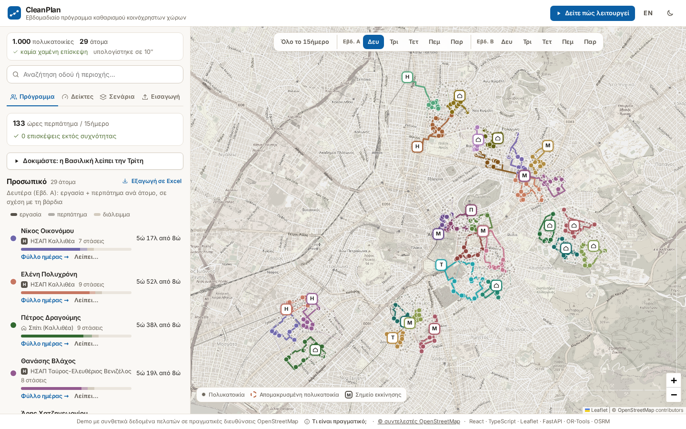
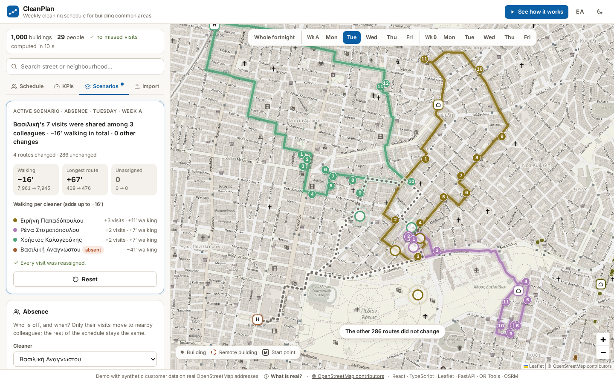
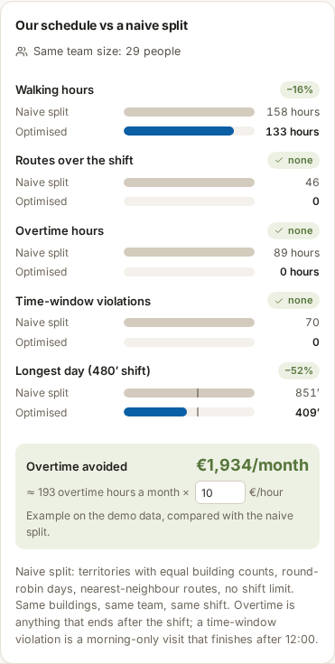

# CleanPlan Athens

Walking-route cleaning schedules for 1,000 apartment buildings (πολυκατοικίες) in Athens: who cleans
which building, on which days of a two-week cycle, and in what order, on foot.

**Live demo:** https://abdelrhmanayman74.github.io/cleanplan-athens/ (Greek by default, EN toggle)



## What it does

- **Plans the whole fortnight.** 1,000 buildings with weekly, twice-weekly, three-times-weekly or
  fortnightly cleaning; every frequency and spacing rule holds and every route fits the shift.
  29 cleaners on 8-hour shifts, computed in about 11 seconds.
- **Absorbs an absence with minimal change.** If someone is off, only their visits move, to nearby
  colleagues with spare shift time; every other route stays exactly the same.
- **Places a new customer.** Drop a pin: the three best cleaner and day options, with the extra
  walking and the shift slack, without moving any existing building.
- **Answers staffing questions.** How many people a 7- or 9-hour shift needs, re-solved in full.
- **Gives each cleaner a day sheet** on their phone: ordered stops, access notes, check-off,
  Google Maps walking directions, shareable on Viber or WhatsApp.
- **Imports a customer list** (.xlsx/.csv, Greek or English headers) with an offline,
  accent- and Greeklish-tolerant address matcher, and **exports** the schedule to Excel.

| Absence: 7 visits shared among 3 colleagues, the other 286 routes unchanged | Day sheet on the phone |
|---|---|
|  |  |

Compared with a naive split of the same buildings among the same team (equal building counts,
round-robin days, nearest-neighbour routes), the optimised plan walks 16 % less and has no routes
over the shift (naive: 46 routes, 89 overtime hours per fortnight) and no missed morning windows
(naive: 70).



## How it works

Cluster first, route second: workload-balanced territories (k-means seeds plus a min-cost-flow
balance), visit days per territory with CP-SAT, then one small vehicle-routing problem with time
windows per cleaner and day with OR-Tools, plus a repair step when something does not fit. Walking
times and street geometry come from OSRM's foot profile on OpenStreetMap data, precomputed offline.
Details, trade-offs and measured numbers: [ARCHITECTURE.md](ARCHITECTURE.md),
[backend/README.md](backend/README.md); the API: [CONTRACT.md](CONTRACT.md).

Stack: Python 3.11, FastAPI, OR-Tools, OSRM (offline); React, TypeScript, Vite, Leaflet.

## Run it

**Full version (API + optimiser + UI)**, the product:

```bash
docker compose up --build          # http://localhost:8000
```

or without Docker:

```bash
cd backend && uv sync && uv run uvicorn app.main:app --port 8000
cd frontend && npm ci && npm run dev    # http://localhost:5173, proxies /api to :8000
```

Tests: `cd backend && uv run pytest`.

**Static version** (what the live demo runs; no server). The optimiser's results are precomputed
into `frontend/public/static-data/` and replayed in the browser; new buildings, imports and the
Excel export are computed client-side.

```bash
cd backend && uv run python scripts/export_static.py   # only after changing data or the solver
cd frontend && npm run build:static                     # dist/, served under /cleanplan-athens/
```

Pushing to `main` builds and publishes it with GitHub Actions (`.github/workflows/pages.yml`).

## Data

Addresses, building locations and the walking network are real: © OpenStreetMap contributors,
ODbL 1.0. Everything about the buildings as customers (managers, phone numbers, frequencies, service
times, access notes) and the cleaners is synthetic.

## Licences

All runtime dependencies are under permissive licences (MIT, BSD, Apache-2.0); the map uses
Leaflet directly. OpenStreetMap-derived data is ODbL and needs attribution. The full list is in
[ARCHITECTURE.md](ARCHITECTURE.md#ip-and-licences).

---

Built by [abdelrhmanayman74](https://github.com/abdelrhmanayman74).
